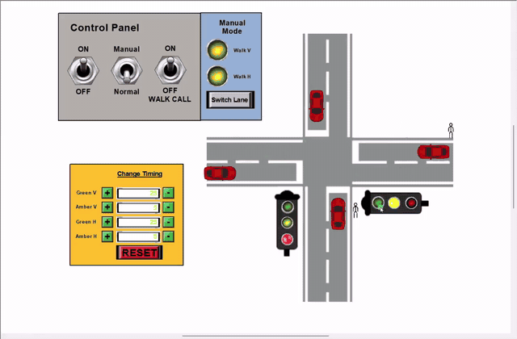
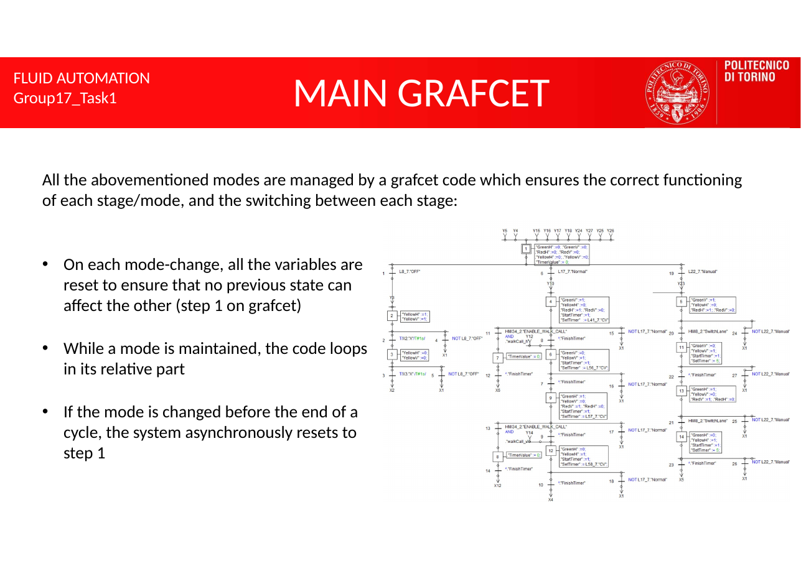
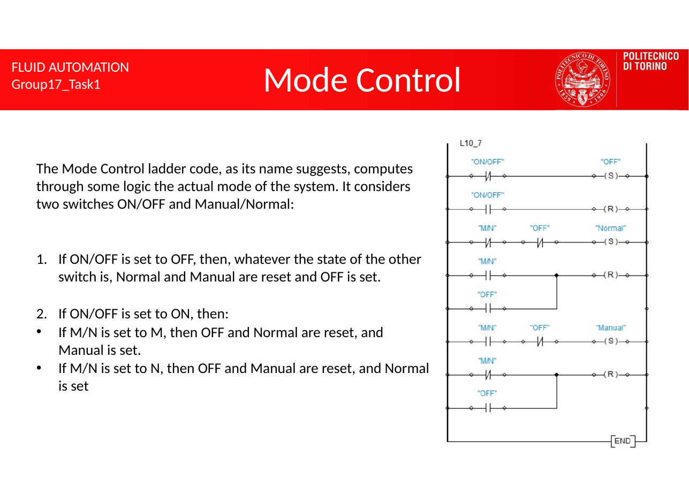
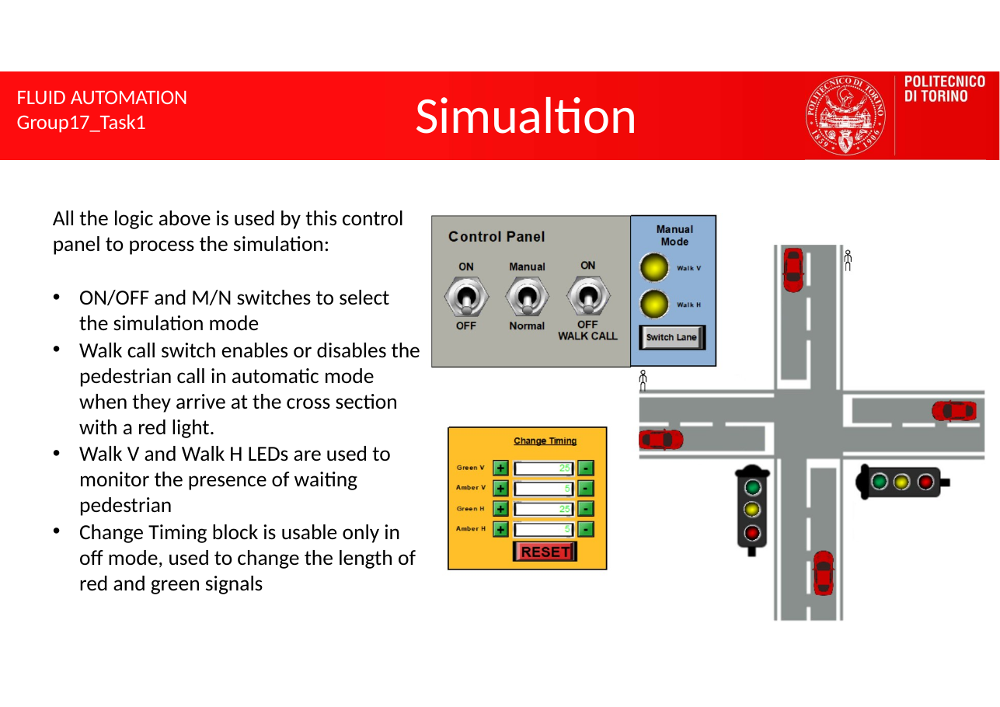

# Traffic intersection controller (Grafcet and Ladder)

Project for the Fluid Automation course at Politecnico di Torino (a.y. 2023/24), designed and built individually.

The controller manages a four-way intersection with traffic lights, pedestrian calls and an operator panel. The cars and pedestrians are simulated with pneumatic cylinders that move only when their light allows it.

## Operating modes

- **Off:** every light blinks yellow at 0.5 Hz. The operator can set the green and red durations from the control panel.
- **Normal:** the green → yellow → red cycle alternates between the vertical and horizontal lanes using the configured durations. If enabled, a pedestrian waiting on the other lane cuts the current green short.
- **Manual:** each change from green to red is triggered by a push button.

## Design

- **Main Grafcet.** Every mode change resets all variables so no previous state leaks into the new mode. While a mode is active the chart loops inside it, and if the mode changes mid-cycle it returns asynchronously to the initial step.
- **Mode control (Ladder).** The ON/OFF and Manual/Normal switches select exactly one of Off, Normal and Manual.
- **Runtime-adjustable timer.** A single 1 s timer drives a counter (`StartTimer`, `FinishTimer`, `SetTimer`, `TimerValue`, `Next`), so the green and red durations can change while the system runs.
- **Pedestrian calls.** `walkCall_v` and `walkCall_h` are set when a pedestrian reaches a red light and reset when that light turns green.
- **Simulation.** A first cylinder brings a car or pedestrian to the crossing, a second one crosses only on green, and their extensions are added to animate each element's position.

| Main Grafcet | Mode control |
| --- | --- |
|  |  |

## Repository contents

| Path | Contents |
| --- | --- |
| `project/traffic-intersection.prx` | Original project file |
| `docs/slides.pdf` | Project report (15 slides) |
| `docs/demo.mp4` | Recording of the simulation in all three modes |
| `docs/img/` | Diagrams and screenshots used in this README |
